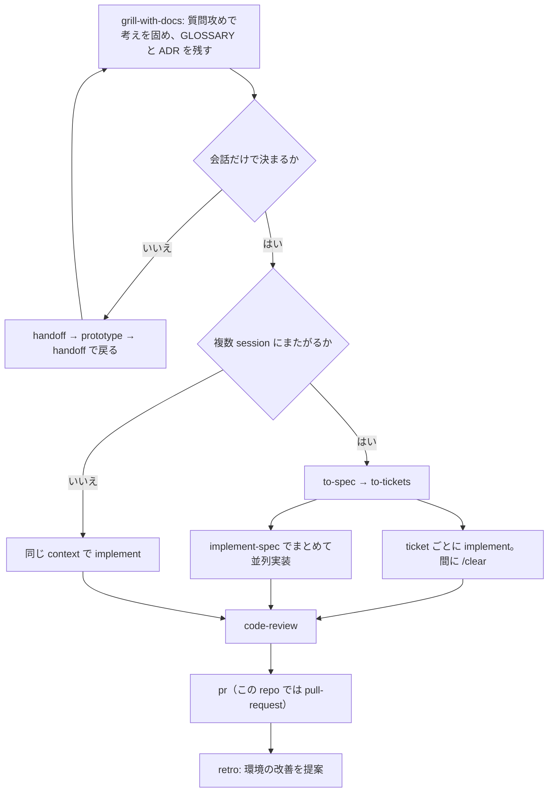

# mattpocock/skills の思想

`upstream/mattpocock-skills` の作者が何を問題と見て、skill の集をどう組んで答えているかをまとめる。fork で何を変えるか、除外中のスキルを使い始めるかを決めるときの物差しにする。

「作者が書いたこと」と「解釈」を分け、解釈には「解釈:」と付ける。作者の言葉の出典は、`README.md`・`SCOPE.md`・`.agents/`・`.out-of-scope/`・`docs/` と各 skill の本文。出典の path は `upstream/mattpocock-skills` から数える。

## 一番の問題: 人と agent の間で意図と知識が失われる

作者はこの集を「vibe coding ではなく real engineering のために毎日使う skill」と位置付ける。GSD・BMAD・Spec-Kit のように開発の流れ全体を握る手法は、利用者から主導権を奪い、流れの中の不具合を直しにくくする、と批判する。対案は「小さく、改造しやすく、組み合わせられる。どの model でも動く」で、「自分のものにしてほしい」と書く。

作者が挙げる 4 つの失敗の型と、その答え（`README.md`）。

| 失敗の型 | 作者の診断 | 答え |
| --- | --- | --- |
| agent が望みどおりに作らない | 人と agent の間の認識のずれ | `grill-me`・`grill-with-docs` で、作る前に質問攻めにさせる。「変更のたびに毎回使え」 |
| agent が冗長 | project の用語を知らないまま、1 語で済むところに 20 語使う | 共有言語の文書 `GLOSSARY.md`。「この repo で一番すごい技法かもしれない」 |
| コードが動かない | 動いた結果を見られない agent は目隠しで飛んでいる | 型・ブラウザ・自動テストという手応えの仕組み。`tdd` と `diagnosing-bugs` |
| 泥団子ができる | agent は書く速度と一緒に劣化の速度も上げる | コードの設計を気にかける。`to-spec` が触る module を問い、`improve-codebase-architecture` を数日おきに回す |

まとめは「ソフトウェア工学の基礎はかつてなく重要になった。この skill 群はその基礎を繰り返せる習慣に凝縮する試み」。

解釈: 4 つとも「agent の能力不足」ではなく「人と agent の間の受け渡しの欠陥」として書かれている。前の 2 つは意思疎通の失敗、後の 2 つは agent の速度に人の検証と設計が追いつかない失敗。

## 答え方の 3 層

解釈: 集全体は次の 3 層で上の問題に答えている。

1. **決定を人に残す。** 流れを組み立てる skill はすべて利用者だけが呼べる形にし、agent が勝手に段を進めないようにする。GSD 批判への構造上の答え。
2. **決定を会話の外に残す。** `GLOSSARY.md`・ADR・spec・ticket・issue・`.out-of-scope/` に書き、context が消えても残す。作者は「spec は context window が終わるから存在する」とまで書く。
3. **古典の工学の規律を、model が自分で引ける参照にする。** TDD、Ousterhout の深い module、Fowler の code smell、DDD の共通言語、Feathers の seam を、model が使える skill として置く。

## 作者の価値観が出ている言い回し

- **人が決め、agent が調べる。** 「事実を見つけるのは agent の仕事で、決めるのは利用者」（`grilling`）。人が加わる ticket で agent が人の側の答えを代わりに出さない（`wayfinder`）。
- **一次情報を守る。** 会話そのものが一次情報で、要約は情報を落とした二次情報。だから段の切れ目では「そのまま続ける」を最初に検討する（`ask-matt`）。prototype も捨てずに別 branch に残し、research も一次情報だけを当たる。
- **smart zone。** model が鋭く考えられる context の範囲には上限があり、超えそうなら区切りのよい所で `/compact` する。subagent を新しい context で始める、spec を挟む、ticket を 1 context に収める、という工夫はどれもこれを守るため。
- **新しい context の subagent。** subagent を出す skill は「新しい context で始めよ」と書く決まりがある。`code-review` は 2 つの観点を別々の subagent に分け、互いに影響させない。
- **古びにくさを精度より優先する。** spec・ticket・agent brief には file path や行番号を書かない。すぐ古くなるから。
- **tracer bullet。** ticket は全層を貫く細い完成品にする。TDD も「テストを全部書いてから実装」を禁じ、1 テスト 1 実装で進める。
- **seam を先に合意する。** テストは合意済みの seam（中を覗かずに振る舞いを観察できる公開の境目）にだけ書く。`to-spec` も書く前に seam を利用者と確かめる。
- **深い module。** 小さな interface の裏に多くの振る舞いを置く。深さを「行数の比」ではなく「interface を 1 単位覚えて得られる振る舞いの量」と定義し直している（`codebase-design`）。
- **必要になってから作る。** `GLOSSARY.md` も `docs/adr/` も、最初の用語や決定が出たときに作る。無いことを指摘したり、先回りで作ったりしない。
- **機械的な違反は検査で止める。** 機械的に判定できる規約は lint や CI にし、判断が要るものだけを文章にする。「検査は落ちるが、規約ファイルの一文は落ちない」（`retro`）。
- **規約は review する側に持たせる。** 実装する agent は探索・実装・デバッグで context が一番逼迫している。review する agent は diff を受け取るだけなので余裕がある。

解釈: 作者は手順より「語」を重んじる。glossary・`codebase-design` の用語表・leading word の理論は同じ信念から来ている。正しい 1 語が、agent の振る舞いを最も安く固定する。

## 何を入れないか

集の運営方針に思想が出ている（`SCOPE.md`・`.out-of-scope/`）。

- 自分が毎日使うものだけを入れる。既存の skill を組み合わせて作れる振る舞いは、新しい skill にしない。
- その組み合わせ（grilling・`to-spec`・`to-tickets`・`implement` を決まった順で回す流れなど）は、使う人が自分の prompt か自分の skill に書く（`.out-of-scope/new-skills.md`）。理由は、skill がどれもずっと保守し続ける面になるため。
- 変更を受け入れるのは、実際の session で起きた失敗で、かつ設定項目・特定の harness（agent を動かす実行環境）向けの分岐・個人の流儀の微調整ではないものだけ。そういうものは各自の `CLAUDE.md` / `AGENTS.md` か fork に書け、とする。
- harness に依存しない文章にする。grilling で Claude Code の `AskUserQuestion`（選択式の質問 UI）を使うことを拒む。選択肢を先に並べる UI は、自分の言葉で答える開いた質問という grilling の目的に反する。
- 質問数に上限を付けない。止めたいときは言葉で指示する。
- subagent の無限再帰は harness が止めるべきもので、skill に防止文を書かない。

## agent 向けの文章の理論

`writing-for-agents` が集全体の書き方を決めている。context pointer の言い回しが発火を決める、常に読み込まれる文の context 負荷と人の認知負荷を天秤にかける、leading word で事前学習済みの概念を 1 語で呼ぶ、否定より肯定で指示する、model が既定で守る指示（no-op）は消す。

`wait-what` が 3 行しかないのはこの理論の実践で、「冗長さを直す 400 行の skill は、model がその長さを真似るので効かない」と作者は書く。

## 構造に出ている思想

### 誰が呼べるか

skill の区別は「誰が呼べるか」の 1 軸だけ（`.agents/invocation.md`）。

- **利用者だけが呼ぶ skill**: `disable-model-invocation: true` を付け、description は人が読む 1 行の要約にする。流れを組み立てる。
- **model も呼べる skill**: description に「Use when ...」で発火条件を並べる。再利用される規律を持つ。
- 判定基準は「model が自分から手を伸ばして役に立つか」で、再利用されるかどうかではない。
- **不変条件**: 利用者だけが呼ぶ skill は、model も呼べる skill を呼べるが、利用者だけが呼ぶ別の skill は呼べない。setup が要る場面では「利用者に `/setup-matt-pocock-skills` を実行するよう伝えよ」と書く。
- 理由: 利用者だけが呼ぶ skill は context 負荷が 0 で、代わりに人が存在を覚える認知負荷を払う。覚えきれなくなったら、それらを案内する skill を 1 つ置く。それが `ask-matt`。

解釈: 流れの各段（質問攻め → spec → ticket → 実装）がすべて利用者だけが呼ぶ skill なので、段から段へ進むのは必ず人になる。agent は段の中で規律の skill を引くだけ。

### skill 同士の呼び方

依存は「Call the Skill tool with "grilling"」のように tool の名前付きで書く。folder をまたぐ `../other-skill/FILE.md` の参照や、本文に `/name` を置いて解釈に任せる書き方はしない。tool の名前を書いた方が発火率が高いから。共有の参照資料は持ち主の skill の中に置く。

### 設定は repo ごと、skill 本体はどこでも同じ

`setup-matt-pocock-skills` が repo ごとに一度だけ、`CLAUDE.md` の `## Agent skills` 節と `docs/agents/*.md`（issue tracker・triage label・domain 文書の読み方）を作る。repo ごとに変わるのはこれらのファイルだけで、tracker を変えても skill 本体は編集しない。

「setup を実行せよ」の 1 行は、設定が無いと出力が「ぼやける」のではなく「間違う」skill だけに入れる。弱い依存の skill は用語集や ADR を曖昧な言い方で参照するだけで、無くても動く。

解釈: 設定は skill への引数ではなく、毎 session 自動で読まれる指示ファイルを経由して届く。

### 流れと段の切れ目

`ask-matt` が地図を持つ。

- grilling・spec・ticket は一続きの context で行い、`/to-tickets` が終わるまで compact も clear もしない。`/implement` は ticket ごとに新しい context で始める。
- 外から来た issue は `triage` で着手できる形にしてから `implement` へ渡す。壊れたものは `diagnosing-bugs` から入る。1 session に収まらない仕事は `wayfinder` で決定の地図を作り、晴れたら `to-spec` に合流する。
- `domain-modeling`（業務の言葉）と `codebase-design`（module 設計の言葉）は、ほかの skill の下で動く語彙の唯一の出典。
- 段の切れ目では、続ける → `/clear` → `/handoff` → subagent → `/compact` の順に検討する。続けることは何も失わない。`/clear` を誤ると「なぜ」を失い、diff を読み返しても戻らない。`/handoff` は harness や directory を変えるとき、同僚に渡すとき、脇道の作業を切り出すときに限る。

解釈: handoff は session を引き継ぐ道具というより、主な流れから prototype へ寄り道して戻るための橋として設計されている。

### engineering と productivity

作者の区分は、engineering が「毎日のコード作業」、productivity が「コードに限らない毎日の作業道具」。

解釈: engineering は repo と issue tracker を前提にし、成果を issue・`GLOSSARY.md`・ADR・branch として repo に残す、状態を持つ流れ。productivity は会話そのものを扱う道具（質問攻め、言い直し、会話の持ち運び、学習、agent 向けの文章）で、repo も setup も要らない。境界は緩く、`grilling` は engineering の複数の skill が中で使う部品になっている。`teach` は学びを Knowledge・Skills・Wisdom に分け、learning record と `GLOSSARY.md` を残す。「決定を会話の外に残す」という集全体の型を学習に当てはめたもの。

## 作者の作業環境が前提になっている所

思想と切り離して、作者の手元の流儀が skill に入り込んでいる所。fork で外す候補になる。

- **GitHub が中心。** 「自分が使っているのは GitHub なので、正しく保てるのはそれ」。sub-issue と issue 同士の依存（blocked-by）を使う。
- **issue を作業の単位にし、AFK agent に拾わせる。** `ready-for-agent` は「人が席を外している間に動く agent がそのまま着手できる」の意味。assignee を着手の印にし、依存 link で着手できる ticket を見せる。
- **OSS の保守者の流れ。** `triage` は外部の PR も依頼として扱い、投稿に AI が書いた旨の断り書きを付ける。
- **確認なしに commit する。** `implement` は今の branch へ確認せずに commit し、`implement-spec` は worktree と統合 branch を使う。
- **英語前提。** `wait-what` は ASD-STE100 Simplified Technical English（航空整備の文書から来た平易な英語の規格）で言い直させる。leading word も英語の語に頼る。
- **TypeScript 中心の例。** `tdd`・`codebase-design`・`prototype` のコード例。
- **一時ファイルは `$TMPDIR`。** handoff と設計改善の report の置き場所。
