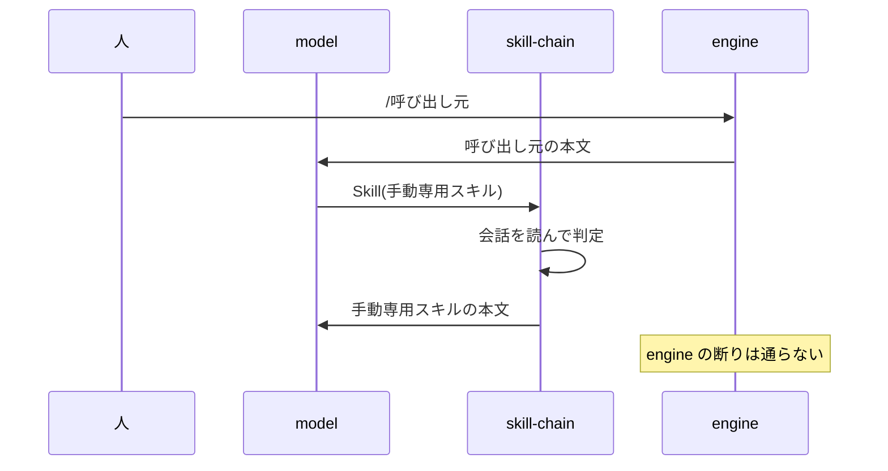

# skill-chain

**手動専用のスキル**（`disable-model-invocation: true` で、人が `/name` と打たないと起動しないスキル）は、Skill tool から呼ぶと engine に断られる。skill-chain は Skill tool の呼び出しを横取りし、**呼び出し元のスキル**（本文に別のスキルを使うよう書いたスキル）の本文か、そのディレクトリに置いた `.md`（プレイブックなど）が手動専用のスキルを名指ししているときだけ、engine の代わりに手動専用のスキルの本文を返す。人が `/name` と打つ経路と、呼び出し元のスキルのない呼び出しは今までどおり。あわせて Skill tool の説明文に 1 文足し、一覧に無い名前でも model が Skill tool を呼ぶようにする（[一覧に無い名前を呼ばせる](#一覧に無い名前を呼ばせる)）。

流れ:

## 背景

pstack は 58 個のスキルのうち `setup-pstack` 以外の 57 個を手動専用にしたうえで、`poteto-mode` から他のスキルを使わせている。

- **狙いは context の節約。** 作者は付ける理由を一度も説明していない（最初の [cursor/plugins#300](https://github.com/cursor/plugins/pull/300) はレビューで理由を聞かれても無回答）。理由が書かれたのは `/poteto-help` に付けた #506（upstream の `00b52d9`）だけで、「説明文から読み込まれるスキルは、その説明文が毎 session のスキル一覧に載る」ことを理由にしている。手動専用のスキルは一覧に載らない。
- **振り分けは `poteto-mode` が持つ。** どのスキルをいつ使うかは `poteto-mode` の本文の索引と規則が決めるので、各スキルの説明文を一覧に並べて model の連想で拾わせる必要がない。「一覧からは隠し、`poteto-mode` と人だけが起こす」構成と読める（作者の言葉ではなく推測）。
- **Claude Code では Skill tool が断る。** [Cursor](https://cursor.com/docs/context/skills) では手動専用は「打ったときだけ context に入る」という意味で、断りはない。Claude Code では Skill tool が断るので、[cursor/plugins#527](https://github.com/cursor/plugins/issues/527) が「hub が振り分け先を見つけられない」と報告した。pstack はスキルを手動専用のまま、置き場所 `../<name>/SKILL.md` を教える形で手当てした（#577、upstream の `364a77e`）。Claude Code 用の [docs/harness/claude-code.md](../../upstream/cursor-plugins/harness/pstack/claude-code/docs/harness/claude-code.md) も、SKILL.md を Read させている。

skill-chain は手動専用のスキルを一覧に戻さないので、context の節約はそのまま残る。そのうえで、呼び出し元のスキルが名指ししたときだけ Skill tool を通し、Read の手当てを置き換える。

## 判定

判定は `tool.call` の `Skill` の hook でする。mod は状態を持たず、呼び出しのたびに `$.session.messages` でその会話（subagent ならその subagent の会話）を読み直す。読み直しても subagent に入っても、同じ答えになる。

1. **呼び出し元のスキルの候補**として、会話で展開済みのスキルの置き場所を集める。
   - role が user の text block で、最初に出てくる「Base directory for this skill: <dir>」の行。engine はスキルを展開した本文の頭にこの行を書く。後ろの行は引数かもしれないので数えない。
   - 会話に残った Skill の `tool_use` のうち、成功の `tool_result` がそろったもの。この mod が返した手動専用のスキルの本文は会話の履歴に入らないので、スキル名を 2 の置き場所の候補から探して置き場所を得る。これで手動専用のスキルが次の呼び出し元のスキルになれる。
   - 候補の本文は、会話の文ではなくディスクから読む。展開された文には呼び出しの引数が付くので、引数で名指しを偽れないようにする。本文は SKILL.md の前書きを除いた部分と、`<dir>` の下（`playbooks/` のような下のディレクトリも含む）にある `.md` すべての中身。symlink はたどらない。
2. **置き場所の候補**は、次の 3 つ。呼ばれたスキルの SKILL.md は、この候補からしか探さない。dawkinsuke の置き場所は最後に探す。
   - 1 の `<dir>` の親ディレクトリ。repo のスキル（`.claude/skills/<name>`）なら、同じ repo の手動専用のスキルを呼べる。
   - その親ディレクトリを持つ plugin が宣言した残りの置き場所。親ディレクトリから上にたどって最初に見つかった `.claude-plugin/plugin.json` を読み、既定の `skills/` と `skills` の一覧のどれかが親ディレクトリと一致したときだけ、それらを候補に足す。1 つの plugin が `matt/skills` と `pstack/skills` のように置き場所を分けても、同じ plugin のスキルなら呼べる。
   - dawkinsuke の置き場所。mod 自身のディレクトリ（`$.plugin.root`）の親から上にたどって最初に見つかった `plugin.json`（mod を持つ dawkinsuke の checkout のもの）の既定の `skills/` と `skills` の一覧を、呼び出し元がどこにあっても足す。repo のスキルのプレイブックから、dawkinsuke の手動専用のスキルを呼べる。user の `~/.claude/skills/` は足さない。
3. 次のすべてを満たしたときだけ答える。
   - 呼ばれた名前が英数字・`_`・`-` だけでできている（置き場所の外へ出ない）。
   - 呼ばれたスキル自身を除く候補のどれかの本文が、その名前を単語として含む。それが呼び出し元のスキルになる。
   - 置き場所の候補に呼ばれた名前の SKILL.md があり、前書きが `disable-model-invocation: true`。つまり手動専用のスキルである。
4. 答えは `{ result: { success: true, commandName }, context: [手動専用のスキルの本文] }`。本文の先頭には engine と同じ「Base directory for this skill:」の行を付け、`$ARGUMENTS` を引数の文字どおりに置き換える。本文に `$ARGUMENTS` が無く引数があるときは、末尾に「ARGUMENTS: <引数>」の行を足す。

どこかで条件を外れたら `next(e)` に渡し、engine が決める。hook が throw したときも engine に戻るので、迷ったときはいつも今までどおり断られる側に倒れる。

## 一覧に無い名前を呼ばせる

手動専用のスキルはスキル一覧に載らず、system prompt は「一覧に無い名前を推測で呼ばない」と model に言う。opus はこれに従い、呼び出し元のスキルが名指ししても Skill tool を呼ばずに自分で済ませるので、上の判定まで届かない。そこで `tool.describe` の hook で Skill tool の説明文の末尾に、「読み込んだスキルの本文が名指ししたスキルは推測ではなく、一覧に無くても呼べる」という決まりを足す。呼び出し元のスキルの本文に断り書きを書かずに済む。足すのは 1 文（約 13 トークン）だけで、tool の説明文は会話に 1 度だけ置かれ、ターンごとにも呼び出しごとにも積み上がらない。手動専用のスキルを一覧に戻すと 1 つごとに説明文が載るので、それより安い。呼び出し元を展開したときだけ足す形は取れない。注記を足せる `prompt.submit` と `command.run` の時点では、スキルの本文も置き場所もまだ分からず、スキル一覧を差し替える `prompt.attachment` の hook は実機で効かなかった（組織の管理 plugin のせいとみている）。

## この形にした理由

- **名指しの根拠を呼び出し元のスキルの本文に限る。** 要望は「呼び出し元のスキルに書かれていたら呼ばれる」こと。人の入力は、もともと `/name` で呼べる。tool の出力（Read したファイル、コマンドの結果）は誰でも書けるので、根拠に数えるとそこから任意のディレクトリのスキルを呼べてしまう。
- **手動専用のスキルに許可リストを書かせない。** 呼び出し元のスキルに書けば足りるようにするのが目的なので、手動専用のスキルの前書きは upstream のまま触らない。
- **他の plugin の置き場所を自前で解決しない。** mod の `$` は他の plugin の置き場所を引けない（`$.command.list()` にパスがない）。install 先をたどってスキルの読み込み処理を作り直す代わりに、会話に残った置き場所を使う。`plugin.json` を読むのは、呼び出し元のスキルと同じ plugin の置き場所と、mod を持つ dawkinsuke の置き場所を足すためだけ。上にたどって最初に見つかった `plugin.json` の宣言に呼び出し元の置き場所が無ければ、別の plugin のものとみなす。dawkinsuke の置き場所は、mod が checkout から直接読まれる（ルートの CLAUDE.md の「mod」の節）ので、mod 自身の位置からたどれる。
- **名指しの根拠をスキルのディレクトリの `.md` まで広げる。** repo の振り分け役のスキル（`.claude/skills/play` など）は、手順をプレイブック（`playbooks/*.md`）に分けて置く。スキルのディレクトリのファイルは、tool の出力や引数と違い、会話の中の文では偽れない。スキルが自分のディレクトリに `.md` を書き出す作りにすると、それも根拠に数えられるので、そうしない。
- **断りの文言を見ない。** engine に一度流してエラー文を見る作りは、文言が変わると壊れる。前書きを自分で読んで決める。
- **フックする event を選んだ理由**（`skill.prompt` や `session.append` を使わない理由）は、実機で確かめた前提として [CLAUDE.md](CLAUDE.md) にある。

## やらないこと

engine の Skill tool を通らないので、返す手動専用のスキルの本文には次が効かない。pstack の Read のハックと同じ範囲。

- 本文中の `` !`cmd` `` の展開
- 前書きの `allowed-tools`・`model`・`context: fork`

他に、次の制限が残る。

- 呼び出し名の `plugin:` の前置きは見ない。置き場所の候補の 2 か所（別の plugin どうしでも、同じ plugin の `matt/skills` と `pstack/skills` でも）に同じ名前のスキルがあると、先に見つかった置き場所のものを返す（コードの `shortcut:`）。
- 手動専用のスキルの本文は system-reminder（後ろに付くシステムからの補足）として届くので、本物のスキルの展開より model に疑われやすい。haiku は従うのをためらうことがある。

## 確かめ方

単体テストは `claude plugin test mods/skill-chain`。engine との組み合わせは `fixture/` を使って実機で確かめる。手順は [CLAUDE.md](CLAUDE.md) と [fixture/README.md](fixture/README.md) にあり、本物の Claude Code の画面で流すときは `/verify-mods` を使う。
